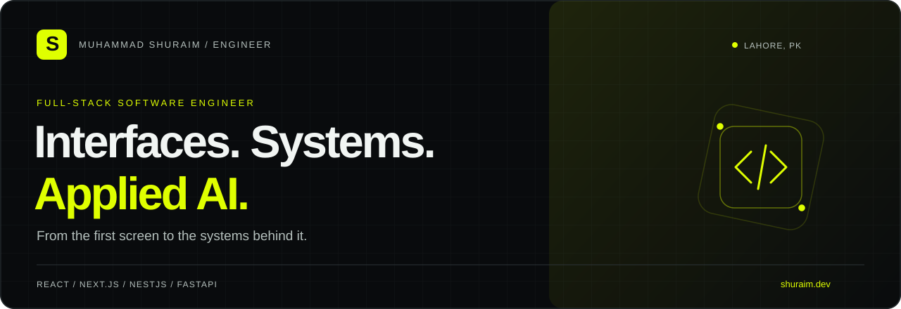
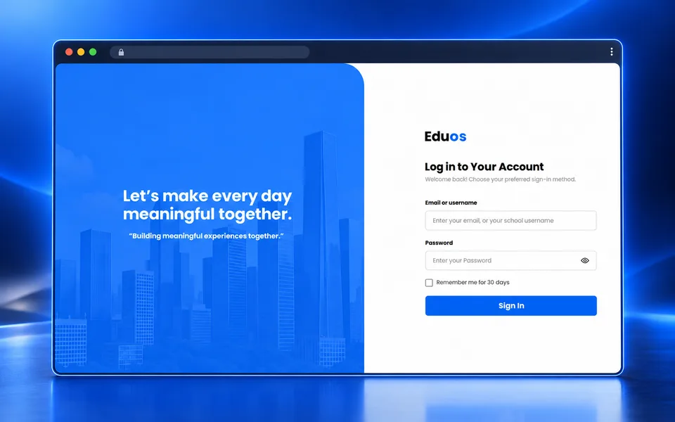
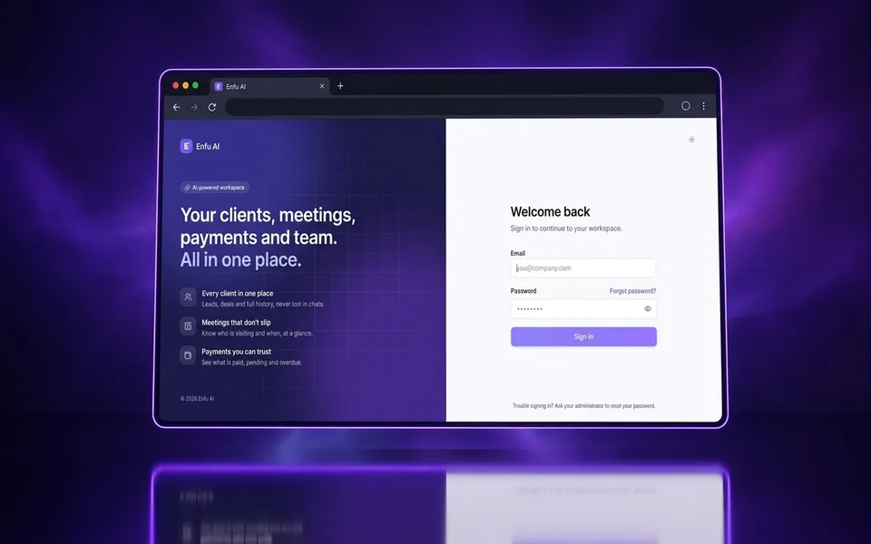
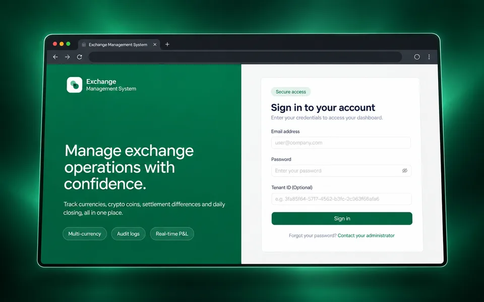
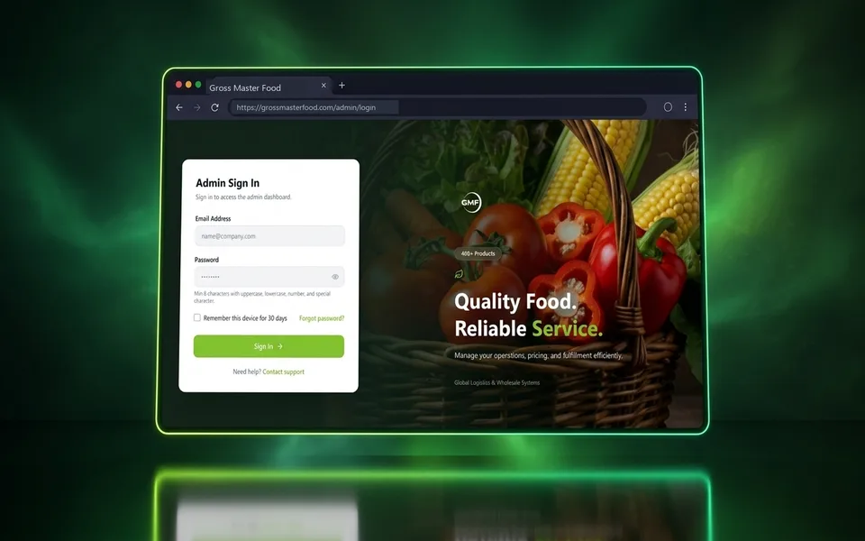

  <a href="https://shuraim.dev"><strong>Portfolio</strong></a> &nbsp; / &nbsp;
  <a href="https://shuraim.dev/projects"><strong>Case studies</strong></a> &nbsp; / &nbsp;
  <a href="https://www.linkedin.com/in/muhammad-shuraim-84169631a"><strong>LinkedIn</strong></a> &nbsp; / &nbsp;
  <a href="mailto:shuraimbutt4@gmail.com"><strong>Email me</strong></a>

I build the interfaces people use and the systems behind them. I'm **Muhammad Shuraim**, a full-stack software engineer in **Lahore, Pakistan**, currently an **Associate Software Engineer at Enfu Solutions**.

My work spans multi-tenant education platforms, financial operations, commerce, and AI connected to real business workflows. I work across **React / Next.js, TypeScript, NestJS, FastAPI, and PostgreSQL**—from the first screen to deployment.

**Open to remote full-stack and backend roles, freelance projects, and engineering collaborations.**

---

## Selected work

### 01 / EduOS
**Multi-tenant school ERP & LMS · Enfu Solutions**

A school platform connecting administration, teachers, students, and drivers. **Version 1 is live in two schools with approximately 5,000 users; version 2 is in development.**

- Built the teacher, student, and driver portals, plus approximately half of the administration screens.
- Designed and implemented the Student and Teacher backend services within a five-developer team.
- Worked across campus-scoped access, academic workflows, and a NestJS service architecture.

`React` `TypeScript` `NestJS` `PostgreSQL` `Prisma` `Redis`

[Explore the case study →](https://shuraim.dev/projects/eduos)

### 02 / Enfu AI
**AI-connected CRM & ERP · Enfu Solutions**

An enterprise AI workspace connecting sales conversations, CRM, ERP, and production analytics for energy manufacturing.

- Engineered dual-model Gemini routing with failover, token quotas, and background processing.
- Implemented ERP-backed price verification and outbound PII sanitization.
- Built voice, image, and receipt ingestion, plus natural-language analytics and a React workspace.

`Python` `Frappe / ERPNext` `React` `Gemini` `Redis` `MariaDB`

[Explore the case study →](https://shuraim.dev/projects/enfu-ai)

### 03 / Exchange Management System
**Foreign-exchange operations · Enfu Solutions · Deployed in Turkey**

A tenant-aware workspace for currency accounts, settlements, approvals, daily closing, and financial reporting.

- Owned most of the frontend implementation, including dashboard and operational screens.
- Built modular, lazy-loaded feature routes with tenant-aware access and action permissions.
- Contributed reporting workflows, statements, and PDF exports.

`React` `TypeScript` `TanStack Query` `Ant Design` `Tailwind CSS`

[Explore the case study →](https://shuraim.dev/projects/exchange-management-system)

### 04 / Gross Master Food
**B2B / B2C commerce & supply chain · Enfu Solutions · Deployed in Barcelona**

A commerce platform connecting wholesale negotiation, procurement, inventory, and retail operations.

- Engineered modular NestJS backend features for orders, procurement, inventory, and access control.
- Implemented line-item price negotiations, counter-offers, and audit trails.
- Built React administration workflows and interactive business analytics.

`NestJS` `TypeScript` `PostgreSQL` `TypeORM` `Redis` `React` `Docker`

[Explore the case study →](https://shuraim.dev/projects/gross-master-food)

> These are commercial team projects at Enfu Solutions. Source repositories are private; the case studies describe the product context and my personal contributions.

---

## Beyond client work

**AI Attendance Register** — independently built an attendance product across FastAPI, Next.js, and a face-recognition pipeline. Includes multi-frame confirmation, manual review, biometric consent and retention controls, and reporting. **Deployment in progress.** [Project details →](https://shuraim.dev/projects/attendance-register)

**Public code to explore**

| Project | Focus | Source |
| :--- | :--- | :--- |
| Enterprise E-commerce | FastAPI / PostgreSQL backend with a Next.js frontend | [API](https://github.com/MuhammadShuraim3637/Enterprise-Ecommerce-API) · [Frontend](https://github.com/MuhammadShuraim3637/Enterprise-Ecommerce-Frontend) |
| AI Blog Studio | AI-assisted blog generation with Next.js and Gemini | [Repository](https://github.com/MuhammadShuraim3637/Ai-Blog-Studio) |
| ParkMaster | MERN parking reservations and booking workflows | [Repository](https://github.com/MuhammadShuraim3637/-ParkMaster---MERN-Parking-Slot-Booking-System) |

## Engineering toolkit

| Area | Technologies I use |
| :--- | :--- |
| Interfaces | TypeScript, React, Next.js, Tailwind CSS, Ant Design, TanStack Query |
| APIs & systems | Node.js, NestJS, Python, FastAPI, REST APIs, multi-tenant applications, RBAC |
| Data | PostgreSQL, MongoDB, Redis, Prisma, TypeORM, SQLAlchemy |
| Applied AI | Gemini, model routing, multimodal ingestion, ERP-backed guardrails, OpenCV |
| Delivery | Git, Docker, Vercel |

## Experience

**Associate Software Engineer · Enfu Solutions**  
June 2026 — Present · Lahore, Pakistan  
Building full-stack products, backend services, and AI integrations across education, financial operations, and commerce.

**Full Stack Developer · IT Genesis Software House**  
May 2025 — May 2026 · Lahore, Pakistan  
Developed full-stack applications with Next.js, Node.js, NestJS, and TypeScript. Delivered a client complaint-management system end to end, including authentication, operational workflows, and deployment. [Case study →](https://shuraim.dev/projects/complaint-management-system)

---

### Have a product or engineering problem in mind?

I'm interested in work where thoughtful interfaces meet substantial backend problems.

**[Let's talk →](mailto:shuraimbutt4@gmail.com)** · [Portfolio](https://shuraim.dev) · [LinkedIn](https://www.linkedin.com/in/muhammad-shuraim-84169631a)
